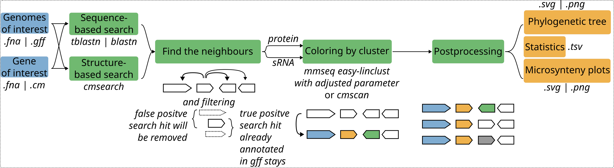

# WORK IN PROGRESS
This pipeline is work-in-progress, you might find bugs, some are known, while others remain undiscovered. Before getting desperate, please check out the Issues that are already opened and discussed. We encourage the community to contribute by reporting any issues they encounter on GitHub. Feel free to reach out to me via email (maria.schreiber@uni-jena.de) or open an issue directly. It's important to note that I cannot be held responsible for any results obtained using SweetSynteny or any conclusions drawn from them.

***
# SweetSynteny - Unraveling Microsynteny Patterns
SweetSynteny identifies microsynteny patterns (conservation of gene order and orientation within small genomic regions) across genomes by combining sequence-based clustering, gene-context analysis, and visualization. It supports both protein and non-coding RNA searches and produces phylogenetic, cluster, and neighborhood summaries.

Microsynteny provides crucial insights into evolutionary relationships and functional conservation. 

Key features of SweetSynteny:
- Flexible input:
    1. different number of organisms (from bacteria to eukaryotes)
    2. different searches (`cmsearch` for sRNA or `blast` for protein or with the gff files `from_gff`)
- Data filtering (E-value, hit length)
- Sequence-driven clustering and color-pattern Microsynteny clustering
    1. on sequence / structur level: `mmseq easy lineclust` or `cmscan` or `hmmscan` (see table)
    3. pca for dimension reduction
    2. on microsynteny level: on global level: microsynteny cluster by ward or dbscan 
- Comprehensive results:
    1. phylogenetic trees using `dendrogram` build by scipy.cluster.hierarchy or scatterplot
    2. statistical summaries of adjacent genes and genome location
    3. microsynteny plots
    4. statistics on the similarity of the microsynteny locations, e.g. cosinus similarity
    5. Optional: get gene of interest sequence and its promoter sequence (default: 100 nt upstream or up to the next adjacent gene)
- Implementation: Nextflow

| Contig:Counter | Gene Name          | Start  | Stop   | Strand| Bio_type       | Color   |
|-----------------|--------------------|--------|--------|-------|----------------|---------|
| NZ_CP013002.1:0 | gene-AQ619_RS00960 | 215167 | 216307 | sense | protein_coding | #FFFFFF |

So, as you can see, with SweetSynteny, your Microsynteny analysis will be, well... sweet!

***

## Graphical Workflow



## Dependencies and installation

The pipeline is written in Nextflow. In order to run `SweetSynteny`, I recommend creating a conda environment dedicated for NextFlow.
1. Install [miniconda](https://docs.conda.io/projects/miniconda/en/latest/) or [conda]()
2. Create a conda environment and install NextFlow within this environment and install everything else.
    ```bash
    mamba create -n env_name
    conda activate env_name
    mamba install -c conda-forge -c bioconda   nextflow openjdk   \
        infernal blast mmseqs2   \
        matplotlib pandas platformdirs pytest requests seaborn numpy scipy scikit-learn
    ```
3. sugar
   ```
   pip install rnajena-sugar
   ```
5. Clone the github repository for the latest version of `SweetSynteny`
   ```bash
   nextflow pull rnajena/SweetSynteny
   ```
6.  Done!

## Input layout

Please choose 2 or more genomes you want to search and save them here. Prepare a genome directory containing one subdirectory per genome. Each genome folder should include a GFF annotation file and a FASTA genome file.
- And use following structure:
  
    └── genomes_dir
  
        ├── genome1_dir
  
        │    ├── db.gff
  
        │    └── db.fna
  
        ├── genome2_dir
  
        .    ├── db.gff
  
        .    └── db.fna
    ...

## Usage

Let us briefly go over the most important parameters and options. 

```bash
nextflow run SweetSynteny.nf -params-file /path/to/para.json -c nextflow.config
```

## Key Parameters and Options

### 1. General & Directory Parameters

<samp>output_dir</samp> (String, Required): Path to the output results directory.

<samp>genomes_dir</samp> (String, Required unless skip_to_clustering is true): Path to the directory containing genome subfolders (each containing one FASTA and one GFF file).

<samp>cpus</samp> (Integer, Default: set via Nextflow config / required): Number of CPUs available for search and parallel tasks.

<samp>scale</samp> (String: yes | no, Default: yes): Choose if you want scaled and aligned microsynteny plots.

<samp>svg</samp> (String: yes | no, Default: no): Export plots in SVG format in addition to PNG.

<samp>name_file</samp> (String, Optional): Path to a genome name mapping TSV file (strain, contig, organism_name).

### 2. Search & Query Parameters

<samp>search_types</samp> (String: blastn | blastp | infernal | tblastn | from_gff, Default: blastn): The search method or mechanism used to locate target regions.   bio_type (String: ncRNA | protein): Biological type of the target/query.   

<samp>annotation_type</samp> (String, Default: .gff): Annotation format type (e.g. .gff).

<samp>query</samp> (String, Required unless search_types='from_gff'): Path to the query file (FASTA or Covariance Model .cm).

<samp>skip_to_clustering</samp> (Boolean / String, Default: false): Skip the search/neighbourhood extraction stages and load from a previous run.

<samp>prev_nb_dir</samp> (String, Required if skip_to_clustering is true): Directory containing previous .nb.tsv, .nb.protein.mfaa, and .nb.ncrna.mfna files.

<samp>evalue_threshold_blast</samp> (Float, Default: 1.0): Maximum E-value threshold for BLAST hits.

<samp>evalue_threshold_infernal</samp> (Float, Default: 0.1): Maximum E-value threshold for Infernal/cmsearch hits.

<samp>len_threshold_blast</samp> (Integer, Default: 40): Minimum match length threshold for BLAST.

<samp>len_threshold_infernal</samp> (Integer, Default: 20): Minimum match length threshold for Infernal.

<samp>blast_matrix</samp> (String, Optional): Custom scoring matrix for BLAST searches.

### 3. Neighbourhood Extraction Parameters

<samp>gene_of_interest</samp> (String, Required): Name or identifier of the gene of interest.   

<samp>neighbours</samp> (String, Default: 4,4): Number of flanking genes (x,y) or nucleotide window span (x:y).   

<samp>including_features</samp> (List, Default: [CDS, pseudogene, ncRNA, rRNA, tRNA, infernal]): GFF feature types to include in neighborhoods.   

<samp>ignore_overlaps</samp> (Boolean / String, Default: false): Ignore minor gene overlaps during neighborhood extraction. 

<samp>substring_search</samp> (Boolean / String, Default: false): Enable substring matching for from_gff searches.   

<samp>promoter</samp> (String: yes | no, Default: no): Extract promoter sequence upstream of the GOI.

<samp>promoter_len</samp> (Integer, Default: 100): Length of the promoter region in nucleotides.

<samp>promoter_mode</samp> (String: fixed | to_next_gene, Default: fixed): Promoter extraction mode (fixed length or up to the next adjacent gene).

<samp>overlap_threshold</samp> (Float, Default: 0.75): Minimum reciprocal overlap fraction required for same-strand feature filtering.

### 4. Clustering & Annotation Tools Parameters

<samp>adjacent_gene_clustering</samp> (String, Default: hmmscan,cmscan): Comma-separated tools for protein and ncRNA clustering/annotation.   

<samp>pfam_db</samp> (String, Required if using hmmscan): Path to the Pfam HMM database.  
- please, download the pfam db and call ... 
- wget https://ftp.ebi.ac.uk/pub/databases/Pfam/current_release/Pfam-A.hmm.gz
  gunzip Pfam-A.hmm.gz
  hmmpress Pfam-A.hmm

<samp>rfam_db</samp> (String, Required if using cmscan): Path to the Rfam CM database.   
- please, download the rfam db and call ... 
- wget https://ftp.ebi.ac.uk/pub/databases/Rfam/CURRENT/Rfam.cm.gz
  gunzip Rfam.cm.gz
  wget https://ftp.ebi.ac.uk/pub/databases/Rfam/CURRENT/Rfam.clanin
  cmpress Rfam.cm

<samp>color_scheme_file</samp> (String, Required): Path to the JSON file defining custom plot colors.

5. Advanced Clustering & Plotting Options (passed to plot_context_script.py)
<samp>feature_mode</samp> (String: content | combined | synteny, Default: combined): Neighborhood representation mode (family content, combined position/orientation, or strict synteny).
<samp>position_weight</samp> (Float, Default: 0.1): Weight assigned to GOI-relative position and orientation features in combined mode.

<samp>synteny_weight</samp> (Float, Default: 0.3): Weight assigned to adjacent-gene pair features.

<samp>adjacency_across_gaps</samp> (String: yes | no, Default: yes): Form adjacent-gene pairs across uncoloured/unannotated intervening genes.

<samp>collapse_overlaps</samp> (String: yes | no, Default: yes): Merge same-family overlapping features (e.g., an Infernal hit and its GFF gene).

<samp>overlap_fraction</samp> (Float, Default: 0.5): Overlap fraction needed to classify same-family features as duplicates.

<samp>rare_unit</samp> (String: genome | neighbourhood, Default: genome): Unit used to count rare gene occurrences.

min_features_per_neighbourhood (Integer, Default: 3): Minimum eligible families required to include a neighbourhood in clustering.

<samp>min_cluster_size</samp> (Integer, Default: 2): Minimum number of neighbourhoods required to form a cluster.

<samp>min_coverage</samp> (Float, Default: 0.50): Automatic cut target for fraction of neighbourhoods falling in valid clusters.

<samp>min_cluster_cosine</samp> (Float, Default: 0.5): Minimum mean pairwise cosine similarity required in every cluster.

<samp>cohesion_stat</samp> (String: worst | median | mean, Default: worst): Cluster cohesion statistic applied during automatic tree cutting.

<samp>min_shared_families</samp> (Integer, Default: 2): Minimum number of shared families required for a valid cluster signature.

<samp>signature_fraction</samp> (Float, Default: 0.6): Fraction of cluster members that must share signature families.

<samp>assign_leftovers</samp> (String: yes | no, Default: yes): Assign unclustered neighbourhoods to the most similar cluster.

<samp>assign_min_similarity</samp> (Float, Default: 0.5): Minimum mean cosine similarity required to attach a leftover neighbourhood.

<samp>supercluster_similarity</samp> (Float, Default: 0.30): Similarity threshold for looser second-level supercluster groupings.

<samp>keep_small_hier_clusters</samp> (String: yes | no, Default: no): Retain hierarchical clusters smaller than min_cluster_size instead of classifying them as noise.

<samp>max_hierarchical_samples</samp> (Integer, Default: 10000): Maximum sample size threshold for running hierarchical clustering.

<samp>max_heatmap_features</samp> (Integer, Default: 500): Maximum number of features displayed in hierarchical heatmaps.

<samp>density_clustering</samp> (String: yes | no | only, Default: yes): Run HDBSCAN density clustering alongside hierarchical clustering.

<samp>hdbscan_selection</samp> (String: eom | leaf, Default: eom): HDBSCAN cluster selection method (eom for larger clusters, leaf for finer clusters).

<samp>min_samples</samp> (Integer, Default: 1): HDBSCAN min_samples parameter.

<samp>noise_penalty</samp> (Float, Default: 0.25): Penalty weight for noise points when selecting HDBSCAN parameters.

<samp>max_hdbscan_candidates</samp> (Integer, Default: 10): Maximum candidate size limit for optimizing HDBSCAN.

<samp>max_silhouette_samples</samp> (Integer, Default: 1000): Maximum sample size used for silhouette score evaluation.

<samp>logo_for_noise</samp> (String: yes | no, Default: no): Generate logos and statistics for noise (-1) and paralog overflow (9999) groups.cut_height_args (Float, Optional): Fixed dendrogram cut height. Omit or set to 0 for automatic cut selection.   

<samp>metric</samp> (String: cosine | euclidean, Default: cosine): Distance metric used for clustering.

<samp>linkage_method</samp> (String: average | ward, Default: average): Hierarchical linkage method.

<samp>remove_core_genes</samp> (String: yes | no, Default: yes): Filter out universal core genes.

<samp>core_threshold</samp> (Float, Default: 0.99): Prevalence threshold above which a gene is treated as a core gene.

<samp>remove_rare_genes</samp> (String: yes | no, Default: yes): Filter out ultra-rare genes.

<samp>rare_min_count</samp> (Integer, Default: 2): Minimum occurrence count required to keep a rare gene.

<samp>min_gene_prevalence</samp> (Float, Optional): Fraction representing the top X% most frequent genes to include.

<samp>paralog_resolution</samp> (String: none | reassign | overflow_only, Default: none): Strategy for resolving paralog conflicts.
<samp>paralog_sim_threshold</samp> (Float, Default: 0.5): Similarity threshold used during paralog resolution.

<samp>microsynteny_logo</samp> (String: yes | no, Default: no): Generate detailed microsynteny logo plots for clusters.   

<samp>network_similarity_threshold</samp> (Float, Default: 0.5): Minimum cosine similarity threshold required to draw an edge in the network graph.

### Use a config file.

See example `para.json`

### Output interpretation

SweetSynteny generates:

- 0_metadata/: Run provenance and software version logs.
- 1_search/: Raw search results.
- 2_neighbour/: Extracted gene neighborhood TSVs and multi-FASTA files (.mfaa, .mfna).
- 3_cluster/: Cluster annotation tables, color-mapped neighbourhood TSVs, and summary files.
- 4_plot/: Genomic context plots, density/hierarchical cluster directories, and summary reports (summary.png, summary.svg, summary.json).

### Other tools
<details><summary>Click here for all citations</summary>

  * SUGAR:
    * `Eulenfeld, Tom. "Sugar: A Python framework for bioinformatics." Journal of Open Source Software 10.111 (2025): 8122.`

  * BLAST:
    * `Korf, Ian, Mark Yandell, and Joseph Bedell. Blast. " O'Reilly Media, Inc.", 2003.`
      
  * INFERNAL:
     * `Nawrocki, Eric P., Diana L. Kolbe, and Sean R. Eddy. "Infernal 1.0: inference of RNA alignments." Bioinformatics 25.10 (2009): 1335-1337.`
       
  * MMSeqs2:
    * `Steinegger, M., Söding, J. "MMseqs2 enables sensitive protein sequence searching for the analysis of massive data sets". Nat Biotechnol 35, 1026–1028 (2017)`
      
  * DNA Features Viewer
    * `Edinburgh Genome Foundry by Zulko. https://github.com/Edinburgh-Genome-Foundry/DnaFeaturesViewer`      
</details>

## Cite us
If you use SweetSynteny for your analysis, please cite our github repository.

```bibtex
@software{Maria_Schreiber_SweetSynteny,
author = {Maria Schreiber, Emanuel Barth, Manja Marz},
license = {MIT},
title = {{SweetSynteny}},
url = {https://github.com/rnajena/SweetSynteny}
}
```
